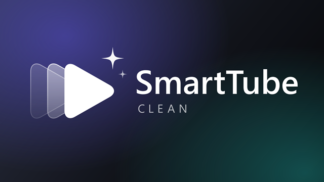
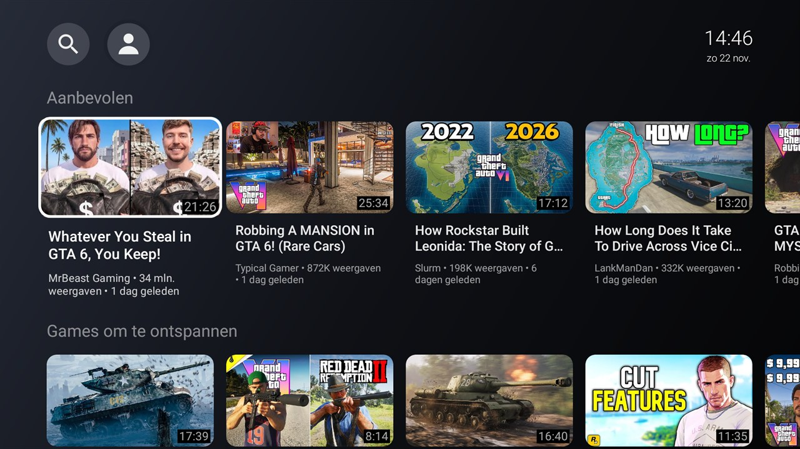
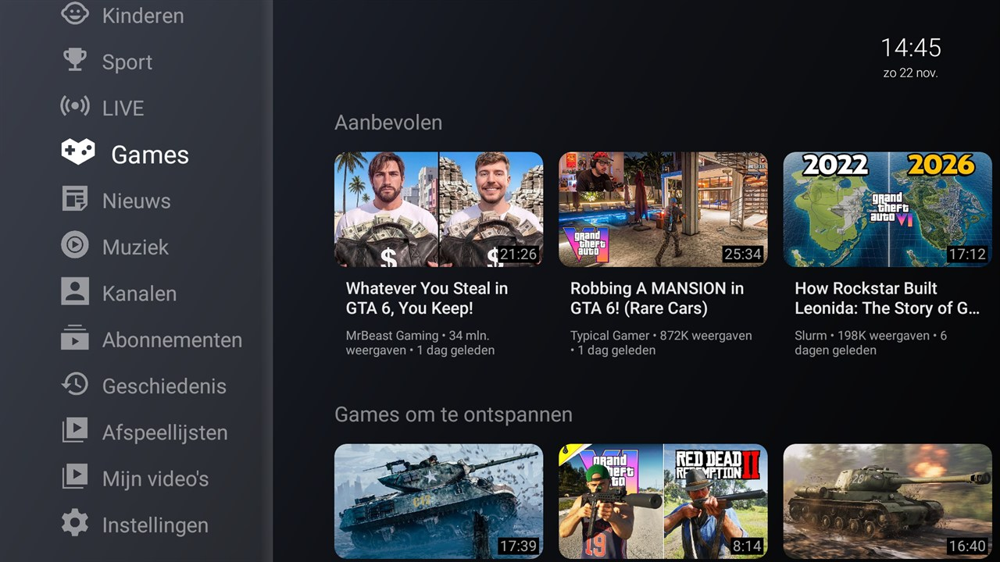
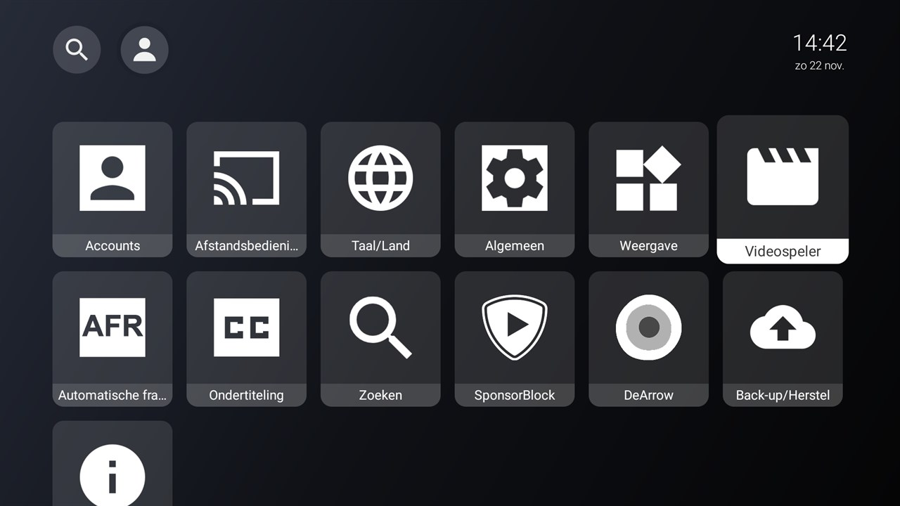
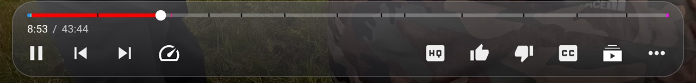

<p align="center">
  
</p>

# SmartTube Clean

My own take on [SmartTube](https://github.com/yuliskov/SmartTube), the YouTube client for Android TV. Same app and same features, with a calmer interface in a glass style and a few changes to how it behaves.

This is an unofficial fork. SmartTube is made by [yuliskov](https://github.com/yuliskov) and its contributors, and everything that makes this app work is theirs. I only wanted to see how clean the interface could get.

## Screenshots

Taken on a TV. The account picture is replaced by a neutral icon, and the player picture shows only the controls bar.

| Browse | Side bar |
|---|---|
|  |  |

| Settings |
|---|
|  |

Player controls:



## What is different

**Player**

- All controls sit on one glass panel: seek bar, time, and both rows of buttons on a single line
- A compact title with the channel line and the current chapter
- Fewer buttons by default. A "More" button at the end lists everything that is not on the bar
- Clock, remaining time and quality info are off by default

**SponsorBlock**

- The position is checked four times a second and the jump happens just before a segment starts, so the skip is hard to notice
- A small glass notification instead of a system toast
- OK within four seconds after a skip jumps back into the segment

**Browse, settings and search**

- A soft gradient backdrop with a translucent side bar
- Video cards without a box: rounded thumbnail, white focus outline, no drop shadow
- Settings panels and dialogs as glass panels
- Every colour scheme has the glass look. Red, blue and monochrome have their own backdrop, the OLED schemes keep pure black

**Other**

- No system navigation sound while moving through the app
- Playback starts after one second of buffer
- Own launcher icon and banner
- Installs next to the official app under its own id, `app.smarttube.clean`

## What is the same

Everything else. For features, device support and the FAQ, read the [original README](../README.md).

## Limits

- The glass is drawn with translucent layers. There is no real background blur, because older Android TV versions cannot do that
- Tested on a single TV running Android 10. Other devices are untested
- A personal project without support. If something breaks only in this fork, open an issue here and not in the SmartTube project

## Build it yourself

No APKs are published here. You need JDK 17 and the Android SDK.

```
git clone --recurse-submodules https://github.com/javevanekris/smarttube-clean.git
cd smarttube-clean
gradlew :smarttubetv:assembleStfdroidRelease -x lintVitalStfdroidRelease
```

The APK lands in `smarttubetv/build/outputs/apk/stfdroid/release/`. For a signed release build, put a `keystore.properties` with your own key in the repo root. That file is ignored by git.

`clean/update.ps1` merges the latest upstream SmartTube into this branch, builds, and can install on a TV over adb. `art/make-icons.ps1` renders the launcher icon and banner.

## Credits and license

SmartTube is the work of yuliskov and its contributors. If you like the app, [support the original project](https://github.com/yuliskov/SmartTube#donation).

MIT, the same as SmartTube. See [LICENSE](../LICENSE).
